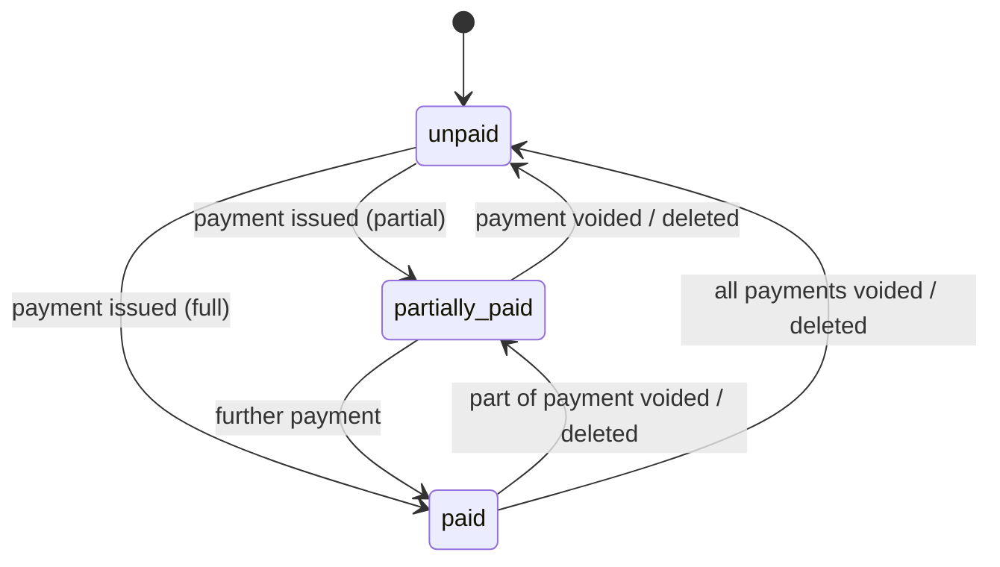
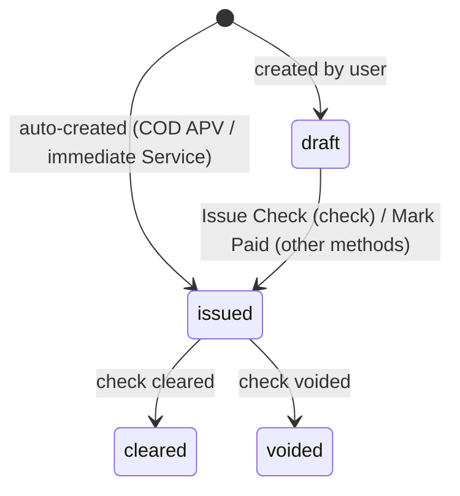
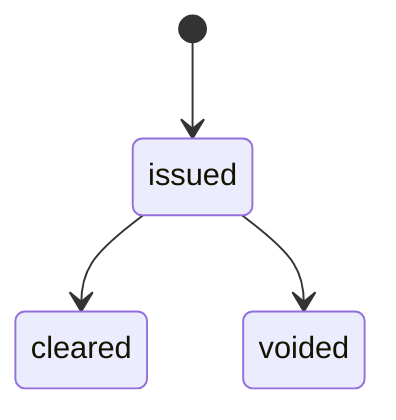
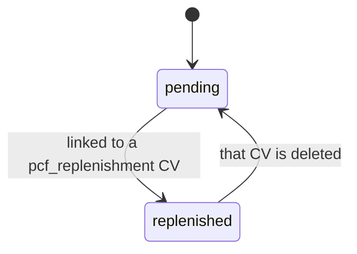
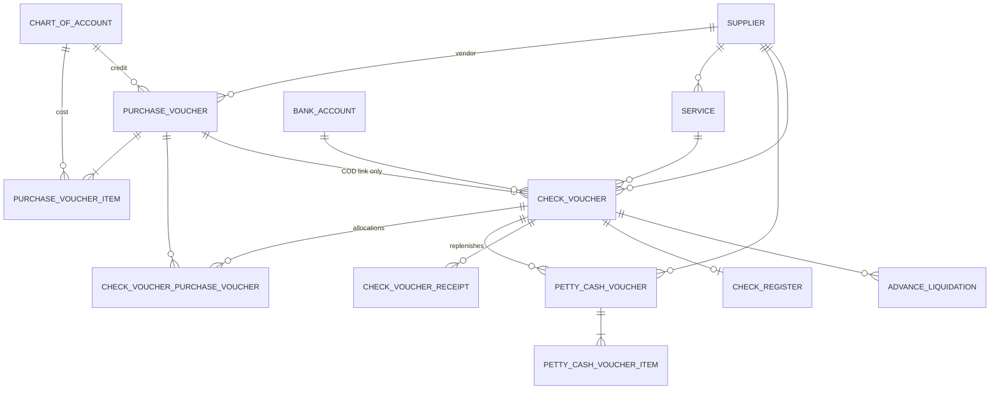

# Disbursement Module — Workflow & Technical Reference

> Standalone, reusable workflow for recording payables and paying them out.
> Written as a reference for rebuilding this module as a SaaS product.
>
> **Scope:** accounts payable (purchases and services), petty cash, cash advances,
> check and non-check payments, the check register, and reporting.
> **Out of scope:** inventory and stock. This module never changes item quantities
> and has no dependency on any receiving, stock or warehouse module.

Sections marked **Current behavior** describe how the existing system works today.
Sections marked **SaaS recommendation** are proposed changes for the multi-tenant
product and do not exist in the current code.

---

## Table of contents

1. [Concepts and vocabulary](#1-concepts-and-vocabulary)
2. [Roles and access](#2-roles-and-access)
3. [Master data](#3-master-data)
4. [Document types at a glance](#4-document-types-at-a-glance)
5. [Workflow A — Purchase Voucher (APV)](#5-workflow-a--purchase-voucher-apv)
6. [Workflow B — Service bill](#6-workflow-b--service-bill)
7. [Workflow C — Petty Cash Voucher (PCV)](#7-workflow-c--petty-cash-voucher-pcv)
8. [Workflow D — Check Voucher (CV) / Disbursement](#8-workflow-d--check-voucher-cv--disbursement)
9. [Workflow E — Check Register](#9-workflow-e--check-register)
10. [Workflow F — Cash advances and liquidation](#10-workflow-f--cash-advances-and-liquidation)
11. [Status machines](#11-status-machines)
12. [Calculations: VAT, EWT and totals](#12-calculations-vat-ewt-and-totals)
13. [Validation rules](#13-validation-rules)
14. [Numbering and references](#14-numbering-and-references)
15. [Data model](#15-data-model)
16. [Side effects and recomputation](#16-side-effects-and-recomputation)
17. [Reports and exports](#17-reports-and-exports)
18. [Attachments](#18-attachments)
19. [API surface (current routes)](#19-api-surface-current-routes)
20. [SaaS recommendations](#20-saas-recommendations)
21. [End-to-end scenarios](#21-end-to-end-scenarios)

---

## 1. Concepts and vocabulary

| Term | Meaning |
|---|---|
| **APV** — Accounts Payable Voucher (Purchase Voucher) | A bill from a vendor for goods bought on credit or cash-on-delivery. Creates a payable. |
| **Service** | A bill for a service (electricity, water, internet, professional fees, etc.). Creates a payable. |
| **PCV** — Petty Cash Voucher | A small expense already paid out of the petty cash fund. Waits to be replenished. |
| **CV** — Check Voucher / Disbursement | The actual payment record. Every peso that leaves the business goes through a CV, whatever the payment method. |
| **Check Register** | The log of physical checks written against CVs paid by check. |
| **Advance** | Money handed out before the expense is known; later accounted for through liquidations. |
| **Receipt** (on a CV) | A supplier invoice line attached directly to a CV that has no parent bill (COD / other disbursements). |
| **APV allocation** | The share of one CV's payment applied to one APV. One CV can pay several APVs. |
| **VAT** | Value-added tax, currently 12%, included in the "amount with VAT". |
| **EWT** — Expanded Withholding Tax | Tax the payer withholds from the supplier and remits to the government. Reduces the cash paid, not the obligation. |
| **Payable total** | What is owed on a bill: amount with VAT + VAT-exempt + non-VAT. |
| **Amount paid** (on a CV) | Cash actually released: total − EWT. |

**The core rule:** bills (APV, Service, PCV) record *what is owed*. Check Vouchers
record *what was paid*. A bill's status is always derived from the CVs that
settle it — it is never set by hand.

---

## 2. Roles and access

### Current behavior

| Role | Access to the disbursement module |
|---|---|
| `admin` | Full access. Can work in "all branches" mode or pick one branch. The only role that can delete a Check Voucher and correct a replenished PCV's date. |
| `branch_manager` | Full access, locked to their own branch. |
| `regular_user` | No access. |

Branch scoping:

- **Admin, "all branches" selected:** sees every branch's records. Must choose a
  branch on forms where one can't be inherited.
- **Admin, one branch selected:** behaves like a manager of that branch.
- **Branch manager:** every list, lookup and new record is scoped to their branch.
  Opening another branch's record returns **403**.
- Records with no branch (legacy data) can be opened by any user and still appear
  in the payment lookups (unpaid APVs, Services, PCVs).

### SaaS recommendation

Replace fixed roles with permissions so tenants can build their own roles. Suggested
permission set:

```
disbursement.apv.view | create | edit | delete
disbursement.service.view | create | edit | delete
disbursement.pcv.view | create | edit | delete
disbursement.cv.view | create | approve | pay | void | delete
disbursement.check.issue | clear | void
disbursement.advance.liquidate
disbursement.reports.view | export
disbursement.settings.manage          # accounts, bank accounts, tax rates
```

---

## 3. Master data

These are maintained separately and referenced by every document.

### 3.1 Chart of Accounts

| Type | Used for |
|---|---|
| `debit_expense` | Cost/expense lines on APV items, PCV items, Services, CV receipts, advance liquidations. |
| `debit_asset` | Asset purchases on APV items and CV receipts; asset-type advances (e.g. "Advances – Staff"). |
| `credit_liability` | The payable account an APV is credited to (e.g. "Accounts Payable – Vendor X"); liability-type advances. |

Rules:
- Account names must be unique after normalization — case, spacing and
  singular/plural are ignored ("Meal Expense" = "Meals Expense").
- Accounts are deactivated, not deleted. Inactive accounts disappear from pickers
  but stay on historical records.

### 3.2 Suppliers / Vendors

Fields: name, type (`company` | `sole_proprietorship`), company name, business name,
owner name, contact person, phone, email, address, TIN, VAT-registered flag, notes.
The supplier's name, address and TIN pre-fill the payee fields on a CV.

### 3.3 Bank Accounts

Fields: bank name, account name, account number, optional branch, active flag.
An account with no branch is shared by all branches; a branch account appears only
for that branch. Deactivated, never deleted.

### 3.4 Branches

Every document carries a `branch_id`. A CV inherits its branch from what it pays.

---

## 4. Document types at a glance

| Document | Creates a payable? | Settled by | Status field | Editable until |
|---|---|---|---|---|
| APV | Yes | CV (`apv_payment` or auto `cod_purchase`) | `unpaid` / `partially_paid` / `paid` (derived) | First payment recorded |
| Service | Yes | CV (`service_payment` or auto `service_cod`) | `unpaid` / `partially_paid` / `paid` (derived) | First payment recorded |
| PCV | Yes (to the fund) | CV (`pcf_replenishment`) | pending / replenished (derived from link) | Replenished |
| CV | No — it *is* the payment | — | `draft` / `issued` / `cleared` / `voided` | Allocations and receipts stay editable; header is create-once |
| Check Register entry | No | — | `issued` / `cleared` / `voided` | Status changes only |
| Advance liquidation | No | — | — | Create-only |

---

## 5. Workflow A — Purchase Voucher (APV)

Records a purchase from a vendor. Two purchase types:

| `purchase_type` | Meaning | Payment |
|---|---|---|
| `credit` | Bought on terms; paid later. | Paid later through one or more CVs. |
| `cod` | Cash on delivery; paid immediately. | A CV is created automatically in the same transaction. |

### 5.1 Create

1. User enters header: date, branch (admin in all-branches mode only), purchase type,
   vendor, buyer, supplier invoice # (SI #), credit account (credit only), remarks.
2. User adds one or more line items: quantity, unit, particulars, cost account,
   amount with VAT, VAT-exempt amount, non-VAT amount, remarks.
3. For `cod`: user also picks the bank account and payment method
   (`cash` | `bank_transfer` | `online`).
4. System validates (see [§13.1](#131-apv)).
5. System generates the APV number (`APV-000001`, see [§14](#14-numbering-and-references)).
   Any number typed by the user is ignored.
6. System splits each item's VAT-inclusive amount into net + VAT ([§12](#12-calculations-vat-ewt-and-totals)).
7. For `cod` only: system creates a `cod_purchase` CV (status `issued`) for the full
   amount, applies EWT, and recomputes the APV status → `paid`.
8. All of the above runs in one database transaction.

### 5.2 Edit / delete

- Allowed only while status is `unpaid`.
- Edit replaces all line items (delete + re-insert).
- Once any payment exists the APV is locked. To correct it, remove the payment first.

### 5.3 Pay

- From the APV list or detail page, **Pay** opens a new CV pre-filled with this APV
  as the first allocation.
- Payments can be partial and spread over several CVs; one CV can also pay several
  APVs ([§8.3](#83-type-apv_payment--paying-one-or-more-apvs)).

### 5.4 Status

Derived, never edited:

```
payable_total = Σ items (amount_w_vat + vat_exempt + non_vat_purchase)
amount_paid   = Σ APV allocations on CVs with status issued|cleared
              + Σ amount_w_vat of cod_purchase CVs linked to this APV (issued|cleared)

status = paid            if payable_total > 0 and amount_paid ≥ payable_total
       = partially_paid  if amount_paid > 0
       = unpaid          otherwise
```

Payments are counted at their **gross** amount (before EWT). Withholding tax
reduces the cash released, not the amount settled.

---

## 6. Workflow B — Service bill

Same shape as an APV but a single amount instead of line items.

### 6.1 Create

1. Header: date, branch, supplier (required), payor, expense account
   (`debit_expense`), SI #, remarks.
2. Amounts: amount with VAT, VAT-exempt, non-VAT.
3. Payment type:
   - `credit` → paid later through a `service_payment` CV.
   - `immediate` → requires bank account + payment method; the system creates a
     `service_cod` CV (status `issued`) in the same transaction and marks the
     Service `paid`.
4. System generates `SER-000001`.

### 6.2 Edit / delete / status

Identical rules to APV: editable and deletable only while `unpaid`; status derived
from issued/cleared CVs.

> **Current behavior:** a CV can pay only **one** Service. Multi-bill payments exist
> for APVs only.

---

## 7. Workflow C — Petty Cash Voucher (PCV)

Records an expense already paid from the petty cash fund.

### 7.1 Create

1. Header: date, branch, optional supplier, PCV # (typed by the user, must be unique),
   remarks.
2. Line items: quantity, unit, particulars, cost account (`debit_expense`), amount
   with VAT, VAT-exempt, non-VAT, remarks.
3. Validation: every line needs a non-zero amount; the date must be a real
   `YYYY-MM-DD` between 2000 and 2100 (blocks typos like year `0026`).

### 7.2 Replenish

1. The fund custodian creates a CV of type `pcf_replenishment`.
2. They tick one or more un-replenished PCVs.
3. The CV amount must equal the selected PCVs' combined total (±0.01).
4. On save, every selected PCV is linked to the CV → becomes **replenished**.

### 7.3 Locking

- A replenished PCV can't be edited or deleted.
- Exception: an admin can still correct its **date**, because reports classify
  PCVs into months by date and a typo would otherwise be permanent.

### 7.4 Status

| State | Condition |
|---|---|
| Pending replenishment | `check_voucher_id` is null |
| Replenished | `check_voucher_id` is set |

---

## 8. Workflow D — Check Voucher (CV) / Disbursement

Every outgoing payment is a CV, whatever the method.

### 8.1 Common header

| Field | Notes |
|---|---|
| `date` | Required. |
| `cv_no` | Typed by the user. Unique **per disbursement type** (the same number can exist under two types). |
| `reference_no` | System-generated `DIS-000001`. Globally unique. |
| `type` | See [§8.2](#82-disbursement-types). |
| `particulars` | Required description. |
| `payee_name`, `address`, `tin` | Pre-filled from the source bill's supplier; always editable. |
| `payment_method` | `cash` \| `check` \| `bank_transfer` \| `online`. |
| `bank_account_id` | Optional. |
| `ewt_rate` | 0, 1%, 2%, 5% or 10%. |
| `remarks` | Optional. |

If the CV # already exists for that type, the form points the user to the existing
CV's **Add Receipt** feature instead of just rejecting the number.

### 8.2 Disbursement types

| Type | Pays | Amount comes from | Created by |
|---|---|---|---|
| `apv_payment` | One or more APVs | Sum of APV allocations | User |
| `service_payment` | One Service | Entered amount (≤ remaining balance) | User |
| `pcf_replenishment` | One or more PCVs | Entered; must equal PCV total | User |
| `cod_purchase` | Standalone receipts, *or* one COD APV | Sum of receipts / APV total | User, or automatically from a COD APV |
| `service_cod` | One immediate Service | Service total | Automatically only |
| `advance` | A person or advances account | Entered | User |
| `other_disbursement` | Standalone receipts | Sum of receipts | User |

### 8.3 Type `apv_payment` — paying one or more APVs

1. User searches unpaid/partially-paid APVs (branch-scoped, max 20 results).
2. Clicking a result **adds a row**. Each row has an editable amount, defaulting to
   that APV's remaining balance.
3. APVs from **different vendors** may be combined.
4. The **same APV may appear on more than one row** (e.g. two tranches).
5. Payee, address and TIN pre-fill from the first APV and stay editable.
6. CV amount with VAT = Σ allocation amounts.
7. Validation groups rows by APV and checks each APV's **combined** amount against
   its remaining balance.
8. After saving, allocations can still be added, edited or removed on the CV detail
   page. Every change recalculates the CV totals and every affected APV's status.
   A CV must keep at least one allocation — to remove the last one, delete the CV.

### 8.4 Type `service_payment`

Pick one unpaid Service; enter an amount ≤ its remaining balance.

### 8.5 Type `pcf_replenishment`

See [§7.2](#72-replenish).

### 8.6 Types `cod_purchase` / `other_disbursement` — receipts

For payments with no parent bill:

1. User adds one or more receipt rows: SI #, supplier, cost account (required per
   row), amount with VAT, VAT-exempt, non-VAT.
2. At least one receipt must have an amount above zero.
3. CV totals = sums of the receipts. If every receipt uses the same cost account,
   the CV stores it; if they differ, the CV shows a "Split across N accounts" breakdown.
4. After saving, receipts can be added, edited or removed. A CV must keep at least one.

### 8.7 Type `advance`

1. Pick an advance account (`credit_liability` for an advance to a person against
   future purchases; `debit_asset` for a general cash advance).
2. Choose VAT treatment:
   - **With VAT:** amount is VAT-inclusive and split into net + VAT.
   - **Without VAT:** no VAT component. The full amount is also mirrored into
     `non_vat_purchase` so reports classify it correctly; it is not added twice.
3. Liquidation: see [§10](#10-workflow-f--cash-advances-and-liquidation).

### 8.8 Paying out a CV

A new CV starts as `draft` (auto-created CVs start as `issued`).

| Payment method | How it is marked paid |
|---|---|
| `check` | **Issue Check**: enter check date + check # → a Check Register entry is created → the CV becomes `issued`. |
| `cash` / `bank_transfer` / `online` | **Mark Paid** → the CV becomes `issued`. |

Only `issued` and `cleared` CVs count as paid against a bill. `draft` and `voided`
CVs never count.

### 8.9 Delete (admin only)

- Allowed for any type and status.
- Cascades: Check Register entry, receipts, APV allocations, liquidations.
- Replenished PCVs are unlinked (they return to pending).
- **Blocked** for an advance that already has liquidations — void it instead.
- Afterwards, every APV and Service the CV paid is recomputed.

---

## 9. Workflow E — Check Register

1. Created only through **Issue Check** on a CV paid by check. Check # is globally
   unique.
2. Stores check date, check #, payee, particulars, amount (= CV amount paid, after
   EWT), status.
3. Actions (only from `issued`):
   - **Mark Cleared** → register `cleared` → CV `cleared`.
   - **Void** → register `voided` → CV `voided` → the bills it paid lose that payment
     and are recomputed.
4. If a CV's receipts or APV allocations change after the check is issued, the
   register amount is updated to match.

---

## 10. Workflow F — Cash advances and liquidation

```
outstanding_advance = advance amount − Σ liquidations
```

1. The advance CV must be paid out (not `draft`) before anything can be liquidated.
2. Each liquidation records: date, amount, expense account (`debit_expense`), remarks.
3. A liquidation can't exceed the outstanding balance (±0.01).
4. An advance with liquidations can't be deleted — void it instead.

---

## 11. Status machines

### 11.1 APV / Service (derived)



Editable and deletable only in `unpaid`.

### 11.2 Check Voucher



### 11.3 Check Register entry



### 11.4 Petty Cash Voucher



---

## 12. Calculations: VAT, EWT and totals

All amounts are stored as `DECIMAL(14,2)` and rounded to 2 decimals at each step.

### 12.1 VAT split

`amount_w_vat` is always VAT-inclusive.

```
net_purchases = round(amount_w_vat / 1.12, 2)
vat           = round(amount_w_vat − net_purchases, 2)
```

VAT-exempt and non-VAT amounts are **never** run through this split.

### 12.2 Line / bill totals

```
total_purchases = net_purchases + vat + vat_exempt + non_vat_purchase
                = amount_w_vat + vat_exempt + non_vat_purchase
```

Stored as a database-generated column on APV items and Services.

### 12.3 EWT and cash paid (on a CV)

```
EWT base   = net_purchases of amount_w_vat          (all types except advance)
           = stored net_purchases                   (advance; 0 when "without VAT")

ewt_amount  = round(EWT base × ewt_rate, 2)

amount_paid = amount_w_vat + vat_exempt + non_vat_purchase − ewt_amount   (all types except advance)
            = amount_w_vat − ewt_amount                                   (advance)
```

EWT is never withheld on VAT-exempt or non-VAT amounts.

### 12.4 Worked example

APV for ₱11,200 VAT-inclusive, paid with 1% EWT:

| Step | Value |
|---|---|
| amount_w_vat | 11,200.00 |
| net_purchases | 10,000.00 |
| vat | 1,200.00 |
| ewt_amount (1% of 10,000) | 100.00 |
| amount_paid (cash released) | 11,100.00 |
| Amount counted against the APV | 11,200.00 → APV `paid` |

---

## 13. Validation rules

### 13.1 APV

| Rule | Error |
|---|---|
| `date` required | — |
| `purchase_type` ∈ {credit, cod} | — |
| `buyer` required | — |
| `credit_account_id` required for credit; must be `credit_liability` | — |
| `bank_account_id` + `payment_method` required for cod | — |
| At least one item | — |
| Item `particulars` + `cost_account_id` required; account must be `debit_expense` or `debit_asset` | — |
| Each item: amount_w_vat + vat_exempt + non_vat > 0 | "Each item needs an amount…" |
| Vendor + SI # must be unique unless "allow duplicate" is ticked | "This supplier already has a Purchase recorded with Invoice #…" |
| Edit/delete only when `unpaid` | "…has payments recorded against it…" |

### 13.2 Service

Same as APV, plus: supplier required, expense account must be `debit_expense`,
payment type ∈ {credit, immediate}, total > 0.

### 13.3 PCV

`pcv_no` unique, `date` in `Y-m-d` between 2000 and 2100, at least one item, each
item's account `debit_expense`, each item total > 0, not editable once replenished.

### 13.4 Check Voucher

| Rule | Applies to |
|---|---|
| `cv_no` unique within the same `type` | all |
| `payment_method` ∈ {cash, check, bank_transfer, online} | all |
| `ewt_rate` between 0 and 1 | all |
| At least one allocation, each amount ≥ 0.01, APV exists and is in the user's branch | `apv_payment` |
| Each APV unpaid/partially paid; Σ rows per APV ≤ its remaining balance | `apv_payment` |
| Amount ≤ Service remaining balance; Service not fully paid | `service_payment` |
| All selected PCVs still un-replenished; amount = PCV total (±0.01) | `pcf_replenishment` |
| Advance account is `credit_liability` or `debit_asset`; VAT type chosen | `advance` |
| At least one receipt; each has a cost account; total > 0 | `cod_purchase`, `other_disbursement` |
| Branch required when an admin is in all-branches mode and nothing to inherit from | `advance`, receipts types |
| Issue Check only from `draft`; check # globally unique | check payments |
| Mark Paid only from `draft` and not for `check` method | non-check payments |
| Liquidation only after payout; amount ≤ outstanding | `advance` |

Remaining-balance checks allow a ±0.01 rounding tolerance.

---

## 14. Numbering and references

| Document | Format | Source |
|---|---|---|
| APV | `APV-000001` | System, next after the highest existing |
| Service | `SER-000001` | System |
| CV reference | `DIS-000001` | System |
| CV number | free text | User; unique per type |
| PCV number | free text | User; unique |
| Check number | free text | User; globally unique |

For auto-created CVs (COD APV, immediate Service) the CV number is set to the
`DIS-` reference.

> **Current behavior caveat:** numbers are generated by reading the last value and
> incrementing, then checking for a collision. This is not safe under heavy
> concurrency. See [§20.4](#204-numbering).

---

## 15. Data model



### 15.1 Tables

**`purchase_vouchers`** — branch_id, date, apv_no (unique), purchase_type
(credit|cod), vendor_id, buyer, si_no, credit_account_id, status, remarks,
created_by, updated_by.

**`purchase_voucher_items`** — purchase_voucher_id, quantity, unit, particulars,
cost_account_id, amount_w_vat, vat, net_purchases, vat_exempt, non_vat_purchase,
total_purchases (generated), remarks.

**`services`** — branch_id, date, ref_no (unique), supplier_id, payor,
expense_account_id, si_no, service_payment_type (credit|immediate), amount_w_vat,
vat, net_purchases, vat_exempt, non_vat_purchase, total_purchases (generated),
status, remarks, created_by, updated_by.

**`petty_cash_vouchers`** — branch_id, supplier_id, date, pcv_no (unique),
check_voucher_id (null = pending), remarks, created_by.

**`petty_cash_voucher_items`** — same line shape as APV items.

**`check_vouchers`** — branch_id, supplier_id, date, cv_no, reference_no (unique),
type, status, purchase_voucher_id (COD link only), service_id, advance_account_id,
particulars, cost_account_id, bank_account_id, payment_method, payee_name, address,
si_no, tin, amount_w_vat, vat, net_purchases, vat_exempt, non_vat_purchase,
ewt_rate, ewt_amount, amount_paid, remarks, created_by, updated_by.
Unique on (`type`, `cv_no`).

**`check_voucher_purchase_vouchers`** (APV allocations) — check_voucher_id,
purchase_voucher_id, amount_w_vat. No uniqueness: the same APV may appear twice.

**`check_voucher_receipts`** — check_voucher_id, si_no, supplier_id,
cost_account_id, amount_w_vat, vat, net_purchases, vat_exempt, non_vat_purchase.

**`check_register`** — branch_id, check_voucher_id, check_date, check_no (unique),
payee, particulars, amount, status, created_by.

**`advance_liquidations`** — check_voucher_id, date, amount, expense_account_id,
remarks, created_by.

**`attachments`** (polymorphic) — attachable_type, attachable_id, path,
original_name, size, created_by.

**Master data:** `chart_of_accounts`, `suppliers`, `bank_accounts`, `branches`.

### 15.2 Delete behavior

| When this is deleted | These are |
|---|---|
| APV | items, allocations (cascade) |
| CV | receipts, allocations, register entry, liquidations (cascade); linked PCVs unlinked |
| Supplier / bank account / branch | references set to null |

---

## 16. Side effects and recomputation

Bill statuses are recomputed after every event that can change what has been paid:

| Event | Recomputes |
|---|---|
| CV created (auto COD / immediate Service) | the linked APV or Service |
| CV Mark Paid | every APV the CV pays, and its Service |
| Check issued / cleared / voided | same, via the Check Register observer |
| APV allocation added / edited / removed | the CV totals, EWT, register amount, and every affected APV (including one swapped out) |
| Receipt added / edited / removed | the CV totals, EWT, register amount |
| CV deleted | every APV and Service it paid |

All multi-step writes run inside a single database transaction.

---

## 17. Reports and exports

| Report | Content | Export |
|---|---|---|
| Disbursements list (CV index) | Filter by type, status, date range, search (CV #, reference, payee, APV #, Service #). Totals cards: count, amount w/ VAT, amount paid, EWT. | Excel, with creator/updater columns |
| Purchase & Disbursement Summary | Sub-totals per ledger (APV, PCV, CV, Service, Check Register) for a period; four paginated detail tables. | Multi-sheet Excel ledger, one row per line item/cost allocation |
| Unpaid APV Aging | Open APVs grouped into 0–30, 31–60, 61–90, 90+ days with remaining balance. | — |
| Petty Cash Fund | Total spent, total replenished, pending replenishment. | — |
| Outstanding Payables | Open APVs and Services in one list; filter by supplier, buyer/payor, status, date. | PDF |
| Advances | Advance CVs with liquidated vs. outstanding amounts. | — |

Report rules:
- An APV appears in a period if its own date **or** the date of a CV that paid it
  falls in the period.
- PCVs are reported by their own date, not their replenishment date.
- Every report respects branch scoping.

---

## 18. Attachments

- Available on APVs, Services and CVs.
- Up to 10 files per upload, 5 MB each.
- Allowed: jpg, jpeg, png, webp, pdf, xls, xlsx, doc, docx, csv.
- Stored on the public disk with original filename, size and uploader.

---

## 19. API surface (current routes)

All routes require login and the `admin` or `branch_manager` role.

```
# Purchase Vouchers
GET    /purchase-vouchers                     index (filters: search, status, date range)
GET    /purchase-vouchers/create
POST   /purchase-vouchers
GET    /purchase-vouchers/{id}
GET    /purchase-vouchers/{id}/edit
PUT    /purchase-vouchers/{id}
DELETE /purchase-vouchers/{id}

# Services
GET|POST|PUT|DELETE /services...              same shape as purchase vouchers

# Petty Cash Vouchers
GET|POST|PUT|DELETE /petty-cash-vouchers...   same shape
PUT    /petty-cash-vouchers/{id}/date         admin-only date correction

# Check Vouchers
GET    /check-vouchers                        index + totals
GET    /check-vouchers/create                 ?pay_apv=, ?pay_service=, ?replenish_pcv[]=
POST   /check-vouchers
GET    /check-vouchers/export
GET    /check-vouchers/unreplenished-pcvs     JSON lookup
GET    /check-vouchers/unpaid-apvs            JSON lookup (?search=)
GET    /check-vouchers/unpaid-services        JSON lookup (?search=)
GET    /check-vouchers/{id}
POST   /check-vouchers/{id}/issue-check
POST   /check-vouchers/{id}/mark-paid
POST   /check-vouchers/{id}/receipts
PUT    /check-vouchers/{id}/receipts/{receipt}
DELETE /check-vouchers/{id}/receipts/{receipt}
POST   /check-vouchers/{id}/apv-allocations
PUT    /check-vouchers/{id}/apv-allocations/{allocation}
DELETE /check-vouchers/{id}/apv-allocations/{allocation}
POST   /check-vouchers/{id}/liquidate-advance
DELETE /check-vouchers/{id}                   admin only

# Check Register
GET    /check-register
POST   /check-register/{id}/mark-cleared
POST   /check-register/{id}/void

# Master data
/chart-of-accounts   index, create, store, edit, update, toggle-active
/bank-accounts       index, create, store, toggle-active

# Attachments
POST   /attachments/{type}/{id}
DELETE /attachments/{type}/{id}/{attachment}

# Reports
GET /reports/purchase-disbursement/summary (+ /export, JSON feeds)
GET /reports/purchase-disbursement/aging
GET /reports/purchase-disbursement/petty-cash-fund
GET /reports/payables (+ /export/pdf)
GET /reports/payables/advances
```

---

## 20. SaaS recommendations

These do not exist today. They are the gaps to close when turning the module into a
multi-tenant product.

### 20.1 Multi-tenancy

- Add `tenant_id` to every table in [§15](#15-data-model), including master data.
- Enforce it with a global query scope plus database-level composite indexes
  (`tenant_id, …`). Include `tenant_id` in every unique constraint
  (e.g. `tenant_id, type, cv_no`).
- Keep branches as a sub-division inside a tenant.

### 20.2 Configurable tax rules

The current system hard-codes Philippine rules. Move them to per-tenant settings:

| Setting | Current value |
|---|---|
| VAT rate | 12%, VAT-inclusive entry |
| EWT rates offered | 0, 1, 2, 5, 10% |
| EWT base | net of VAT |
| Currency | PHP (₱) |
| Rounding | 2 decimals, half-up, per step |

Consider a `tax_codes` table (code, rate, type VAT/WHT, applies-to) instead of a
single rate, and store the rate used on each document so history never changes.

### 20.3 Approval workflow

The current CV lifecycle has no approval step: `draft` goes straight to paid.
Suggested maker-checker flow:

```
draft → submitted → approved → paid (issued) → cleared
              ↘ rejected → draft
```

- Tenant-configurable approval rules: by amount threshold, disbursement type,
  branch, or payee.
- Multi-level approvals (e.g. manager < ₱50k, finance head ≥ ₱50k).
- The creator of a CV can't approve it.
- Record approver, timestamp and comment per step.
- Apply the same optional flow to APVs and Services before they can be paid.

### 20.4 Numbering

- Use a per-tenant `document_sequences` table (tenant_id, document_type, prefix,
  next_value, padding) and increment it with a row lock
  (`SELECT … FOR UPDATE`) inside the create transaction.
- Let tenants configure prefixes and optional yearly/monthly resets.

### 20.5 Void instead of delete

Today an admin can hard-delete a paid CV and cascade its children. For a SaaS
product:
- Prefer **void with reason** for any CV past `draft`; keep the record.
- Allow hard delete only for `draft`.
- Use soft deletes on bills.

### 20.6 Audit trail

Log every create, update, status change, allocation change, void and delete with
user, timestamp, before/after values and IP. Make it read-only and exportable.

### 20.7 Accounting integration

Generate balanced journal entries from events so the module can feed a general
ledger:

| Event | Debit | Credit |
|---|---|---|
| APV recorded | Item cost/asset accounts; input VAT | APV credit (payable) account |
| APV paid | Payable account | Bank/cash; EWT payable |
| PCV recorded | Expense accounts; input VAT | Petty cash fund |
| PCV replenished | Petty cash fund | Bank/cash |
| Advance paid | Advance account | Bank/cash |
| Advance liquidated | Expense account | Advance account |

### 20.8 Other items

- **Multi-bill payments for Services** (currently APV only).
- **Idempotency keys** on create endpoints to prevent double submission.
- **Events/webhooks:** `bill.created`, `payment.issued`, `payment.voided`,
  `check.cleared`, `advance.liquidated`.
- **Scheduled payments** and due dates / payment terms on bills (aging currently
  uses the bill date).
- **EWT certificates** (e.g. BIR Form 2307) generated per supplier per period.
- **Bank reconciliation** against the Check Register.
- **Recurring bills** for utilities and rent.
- **Supplier portal** (optional) for invoice submission and payment status.

---

## 21. End-to-end scenarios

### 21.1 Credit purchase paid in two tranches

1. Create APV `APV-000010`, credit, ₱22,400.
2. Create CV #1001 (`apv_payment`), allocation ₱10,000 → Mark Paid (bank transfer).
   APV → `partially_paid` (₱12,400 remaining).
3. Create CV #1002, allocation ₱12,400, 1% EWT → Issue Check.
   APV → `paid`. Cash released = ₱12,400 − EWT.
4. The check bounces → Void in the Check Register. CV #1002 → `voided`;
   APV → `partially_paid` again.

### 21.2 One check pays three bills from two vendors

1. Open APVs: A (Vendor X, ₱5,000), B (Vendor X, ₱3,000), C (Vendor Y, ₱2,000).
2. Create one CV; add A, B and C as allocations; payee pre-fills from Vendor X and
   is edited as needed.
3. Issue Check → all three APVs become `paid`, each counting only its own share.

### 21.3 COD purchase

1. Create APV with purchase type `cod`, bank account and payment method.
2. On save the system creates an `issued` `cod_purchase` CV → APV `paid` immediately.

### 21.4 Petty cash cycle

1. Record PCV-101 (₱500) and PCV-102 (₱800) as they are spent.
2. Create a `pcf_replenishment` CV, tick both, amount ₱1,300 → both become
   replenished and locked.

### 21.5 Cash advance

1. CV type `advance`, ₱10,000 to a staff member's advance account → Mark Paid.
2. Liquidate ₱6,500 (Meals) and ₱3,000 (Transportation) → outstanding ₱500.
3. A liquidation above ₱500 is rejected.
